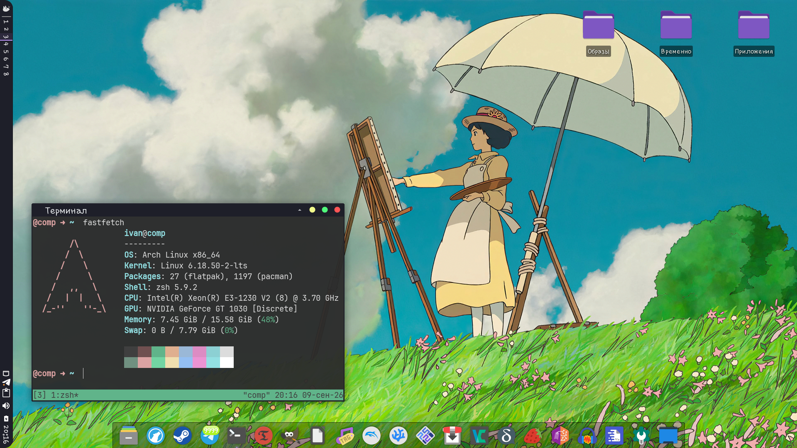
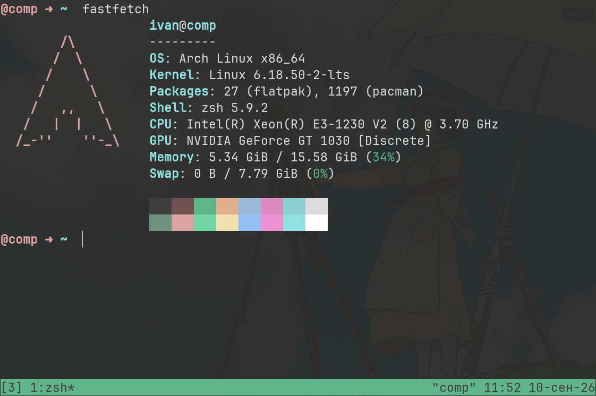
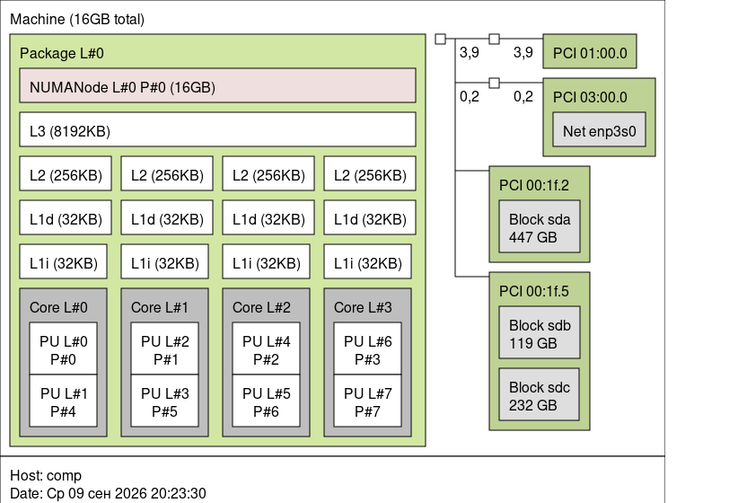
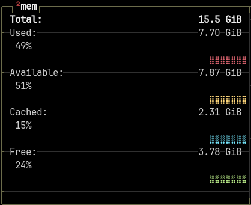
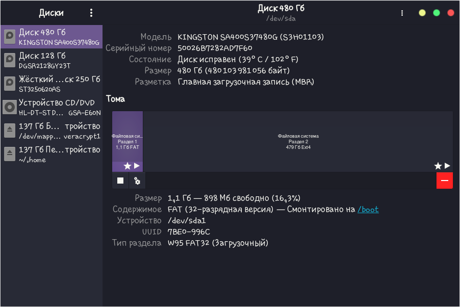
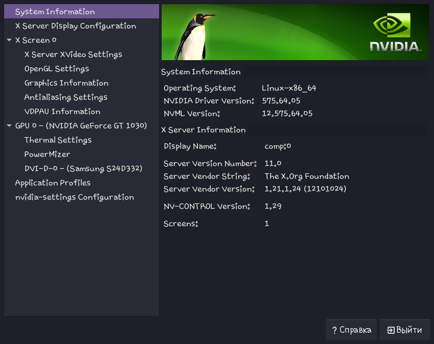
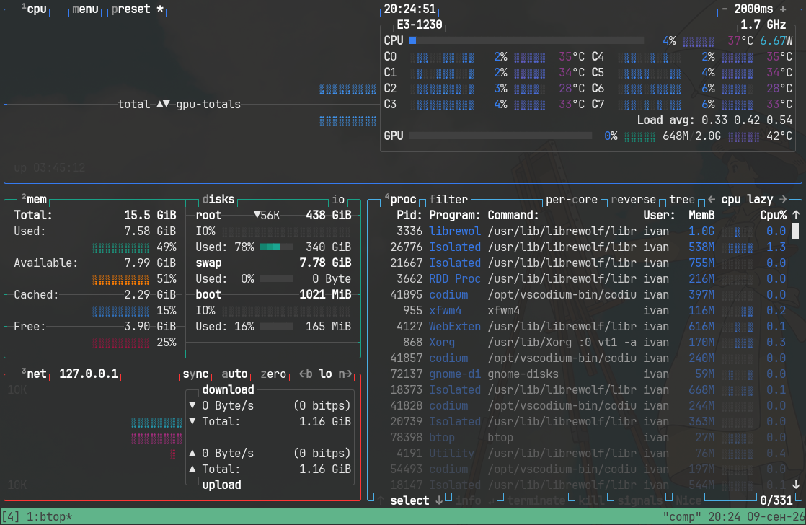
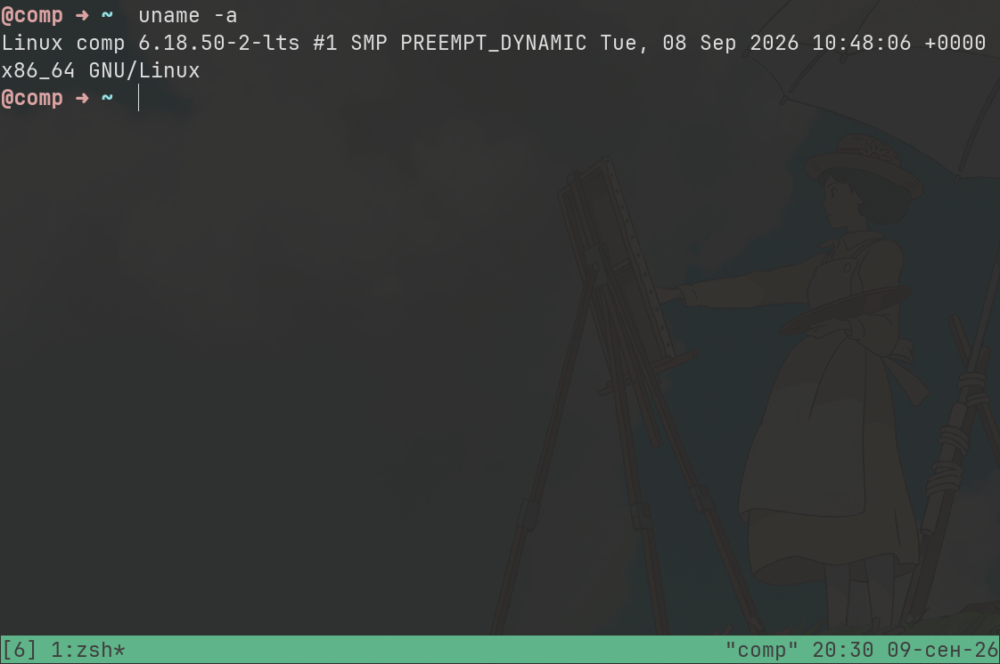

# Паспорт системы

## Характеристики компьютера

**Использованные инструменты:** FastFetch, системные утилиты Linux.

| Характеристика | Значение |
|---------------|----------|
| **Операционная система** | Arch Linux x86_64 |
| **Ядро** | Linux 6.18.50-2-lts |
| **Оболочка** | zsh 5.9.2 |
| **Архитектура** | 64-bit |
| **Процессор** | Intel(R) Xeon(R) E3-1230 V2 @ 3.70 GHz |
| **Физические ядра** | 4 |
| **Логические процессоры** | 8 |
| **Оперативная память** | 16 GiB |
| **Видеосистема** | NVIDIA GeForce GT 1030 [Discrete] |
| **Пакеты** | 1197 (pacman), 27 (flatpak) |
| **Swap(zram)** | 8 GiB |
| **BIOS/UEFI** | UEFI, но система работает в BIOS |
| **Виртуализация** | Включина |

## Скриншоты

### Версия ОС

*На скриншоте отображена информация об ОС: Arch Linux, ядро 6.18.50-2-lts.*

### Информация о системе

*Общие сведения о системе и оборудовании.*

### Процессор

*Модель CPU: Intel Xeon E3-1230 V2, 4 физических ядра, 8 логических процессоров.*

### Память

*Объём ОЗУ: 15.58 GiB, текущая загрузка 47%.*

### Диск

*Информация о накопителях (данные отсутствуют на скриншоте, требуется дополнительная проверка).*

### GPU

*Видеокарта: NVIDIA GeForce GT 1030.*

### Процессы

*Список запущенных процессов.*

### Системная информация

*Подробные сведения о системе.*

### Отчёт
Данного монстра я использовал в очень разных условиях. Такие как: Сборка пакетов для других систем и архитектур посредством виртуализации, 3D графики в Blender и Figma, игры, не оч новые конечно... 